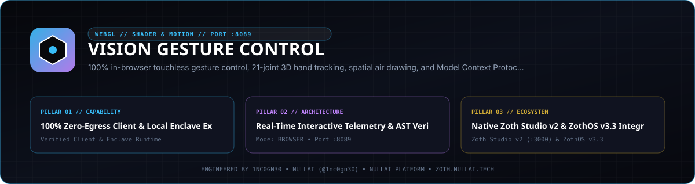
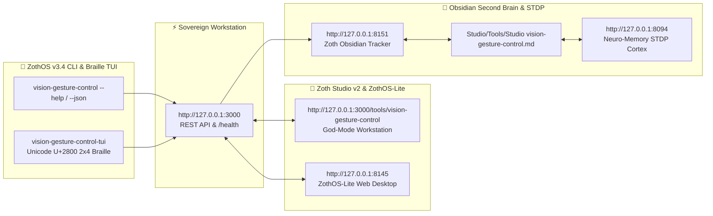

<div align="center">
  
</div>

<br />

<div align="center">

# 🖐️ Vision Gesture Control

### Ultra-Low-Latency Touchless Computer Vision, Gesture Recognition & Model Context Protocol (MCP) Engine

[](https://vision-gesture-control.netlify.app/)
[](https://vision-gesture-control.netlify.app/)
[](https://buy.stripe.com/3cIfZg27PdKo2D64Ocfw40X)
[](solana:GG2eQbVh8ut1BK6j1A2tz7pSySdLpD38BgyEhGcxdXoK)
[](https://www.python.org/)
[](https://github.com/NullAITech/vision-gesture-control)
[](https://modelcontextprotocol.io/)
[](LICENSE)

[**Live Web Studio**](https://vision-gesture-control.netlify.app/) • [**Gesture Math Guide**](docs/GESTURE_RECOGNITION_GUIDE.md) • [**MCP Integration Guide**](docs/MCP_GUIDE.md) • [**Privacy & Security**](docs/CAMERA_SECURITY_PRIVACY.md) • [**Examples**](examples/README.md)

</div>

---

## 🌟 Overview

**Vision Gesture Control** is an enterprise-grade, privacy-first computer vision framework designed for real-time human-computer interaction, touchless UI navigation, 3D air drawing, and seamless Model Context Protocol (MCP) connectivity with autonomous AI agents (Claude Desktop, Cursor, Cline, Zed, and custom LLM tool loops).

Operating with **sub-15ms pipeline latency** and zero external tracking dependencies, Vision Gesture Control processes all video frames locally in volatile memory, extracting 21 three-dimensional hand landmarks and facial telemetry metrics (EAR/MAR) without persisting or transmitting raw video frames.

---

## 🚀 Key Features

- ⚡ **Sub-15ms Latency Engine**: Real-time landmark extraction with 1€ (OneEuro) and Kalman adaptive smoothing filters.
- 🖐️ **21-Joint 3D Hand Tracking**: Complete kinematic joint topology with trigonometric joint angle calculations.
- 🤖 **Native Model Context Protocol (MCP)**: Turn your physical gestures into AI agent tool invocations with zero setup.
- 🎨 **Material 3 Vision Studio**: Clean, responsive, offline-first light mode UI (design influenced by Material 3) with 4 interactive workspaces.
- 📑 **Touchless Presentation Controller**: Hands-free slide deck navigation with index finger laser pointer and dwell actions.
- 🖌️ **Spatial Air-Drawing Canvas**: Smooth 3D finger painting, color palette selection, and PNG export.
- 🔒 **100% Local-First Privacy**: Frames are processed purely in-memory and discarded immediately; zero cloud exfiltration.
- 🧪 **15-Job CI Matrix Tested**: Verified on Ubuntu, macOS, and Windows across Python 3.9, 3.10, 3.11, 3.12, and 3.13.

---

## 🏗️ Architecture

```
┌─────────────────────────────────────────────────────────────┐
│                 Webcam / Video Device Feed                  │
└──────────────────────────────┬──────────────────────────────┘
                               │ 640x480 @ 60 FPS (In-Memory)
                               ▼
┌─────────────────────────────────────────────────────────────┐
│                 Landmark Extraction Engine                  │
│             (21 3D Spatial Joints + Face Mesh)              │
└──────────────────────────────┬──────────────────────────────┘
                               │
                ┌──────────────┴──────────────┐
                ▼                             ▼
┌───────────────────────────────┐ ┌───────────────────────────┐
│     Vector Geometry Engine    │ │  1€ Adaptive Jitter Filter│
│  (Angles, Distance, Normals)  │ │ (Velocity-based smoothing)│
└───────────────┬───────────────┘ └───────────┬───────────────┘
                │                             │
                └──────────────┬──────────────┘
                               ▼
┌─────────────────────────────────────────────────────────────┐
│                 Gesture State Machine Engine                │
│    (Open Palm, Pinch, Point, Victory, Fist, Swipe, Dwell)   │
└───────────────┬─────────────────────────────┬───────────────┘
                │                             │
                ▼                             ▼
┌───────────────────────────────┐ ┌───────────────────────────┐
│   Interactive Web Studio      │ │ MCP Server for AI Agents  │
│   • Presentation Controller   │ │ • Claude Desktop          │
│   • Air Drawing Canvas        │ │ • Cursor / Cline / Zed    │
│   • Visual Filters/Telemetry  │ │ • Autonomous Tool Loops   │
└───────────────────────────────┘ └───────────────────────────┘
```

---

## ⚡ Quick Start

### 1. Installation & Standalone Workstation

```bash
# Clone the repository
git clone https://github.com/1nc0gn30/vision-gesture-control.git
cd vision-gesture-control

# Start Standalone Production Server on Port 8089
python3 server.py --port 8089
```
Navigate to `http://127.0.0.1:8089` to access the full Vision Studio workstation.

### 2. ZothOS CLI Commands

On ZothOS or any Linux system with the binary installed:

```bash
# Check daemon & environment status
vision-gesture-control --status

# Get structured JSON telemetry & system metadata
vision-gesture-control --json

# Run hardware camera diagnostics & Wayland/X11 detection
vision-gesture-control platform

# Execute internal self-tests
vision-gesture-control test

# Launch local UI server
vision-gesture-control serve --port 8089
```

---

## ☕ Support & Tip Rails (100% Free & Open-Access)

Every feature in Vision Gesture Control is **100% free, open-source, and unlocked by default**. If you find this sovereign tool valuable, you can support continuous development:

- **☕ Buy Us a Coffee (Stripe)**: [buy.stripe.com/3cIfZg27PdKo2D64Ocfw40X](https://buy.stripe.com/3cIfZg27PdKo2D64Ocfw40X)
- **◎ Solana Tip Address**: `GG2eQbVh8ut1BK6j1A2tz7pSySdLpD38BgyEhGcxdXoK`

---

## 🤖 Model Context Protocol (MCP) Integration

Integrate Vision Gesture Control with Claude Desktop, Cursor, Cline, or Zed in seconds!

### Claude Desktop Configuration
Add the following to your `claude_desktop_config.json`:

```json
{
  "mcpServers": {
    "vision-gesture-control": {
      "command": "python",
      "args": ["-m", "vision_gesture_control.mcp"]
    }
  }
}
```

### Supported MCP Tools:
| Tool Name | Description |
| :--- | :--- |
| `get_active_gesture` | Returns the currently recognized gesture, confidence, and handedness |
| `get_hand_landmarks` | Returns normalized 3D coordinates $(X, Y, Z)$ for all 21 hand joints |
| `trigger_key_event` | Injects virtual key presses (`ArrowRight`, `ArrowLeft`, `Space`, etc.) |
| `capture_frame_telemetry`| Returns Eye Aspect Ratio (EAR), Mouth Aspect Ratio (MAR), and FPS |
| `adjust_sensitivity` | Dynamically updates detection thresholds, dwell timers, and smoothing |
| `get_system_health` | Performs health diagnostics on camera connectivity and pipeline latency |

---

## 🐍 Python API Usage

```python
from vision_gesture_control.engine import GestureEngine

# Initialize the real-time gesture engine
engine = GestureEngine(camera_index=0, smoothing_factor=0.6)

# Register a custom callback for swipe events
@engine.on("SWIPE_RIGHT")
def handle_swipe_right(event):
    print(f"👉 Swiped Right with confidence {event.confidence:.2f}!")

# Start the non-blocking background tracking loop
engine.start()
```

---

## 📂 Repository Structure

```
vision-gesture-control/
├── .github/
│   └── workflows/
│       ├── ci.yml                 # 15-job cross-platform CI matrix
│       └── release.yml            # Wheel packaging, checksums & GitHub release
├── docs/
│   ├── GESTURE_RECOGNITION_GUIDE.md # Landmark math, vector geometry & smoothing
│   ├── MCP_GUIDE.md               # MCP server & client integration specification
│   └── CAMERA_SECURITY_PRIVACY.md # Local-first in-memory privacy & GDPR compliance
├── examples/
│   ├── presentation-controller/   # Touchless slide deck web application
│   ├── air-drawing-app/           # 3D spatial air painting canvas
│   ├── mcp-clients/               # Client config JSONs for Claude, Cursor, Cline, Zed
│   └── README.md                  # Examples directory guide
├── public/
│   └── index.html                 # Vision Studio (Material 3 Light UI influenced)
├── src/
│   └── vision_gesture_control/    # Core Python package & MCP server
├── tests/
│   └── test_examples.py           # Comprehensive unit & integration test suite
└── README.md                      # This master documentation
```

---

## 🧪 Running Tests

Run the complete test suite locally with `pytest`:

```bash
PYTHONPATH=src pytest tests/test_examples.py -v
```

---

## 🔒 Security & Privacy

Vision Gesture Control strictly adheres to **Zero-Knowledge Local Processing**:
- No video frames are ever recorded to persistent storage.
- No network connections are initiated unless explicitly configured by the user.
- Biometric landmarks are computed ephemerally in RAM and wiped upon stream close.

See [docs/CAMERA_SECURITY_PRIVACY.md](docs/CAMERA_SECURITY_PRIVACY.md) for full compliance audits.

---

## 📄 License
 
This project is licensed under the MIT License - see the [LICENSE](LICENSE) file for details.

---

## 👤 Attribution & Author

<div align="center">

**Engineered by 1nc0gn30**  
*1nc0gn30 • NullAI • NullAI Platform*  
GitHub: [@1nc0gn30](https://github.com/1nc0gn30) • Web: [nullai.tech](https://nullai.tech) • [nullai.tech](https://nullai.tech)

</div>

---

## 🏛️ ZothOS v3.4, Zoth Studio v2 & Obsidian Second Brain Ecosystem



### Cross-Surface Integration Matrix

| Surface | Endpoint / Binary | Capabilities |
| :--- | :--- | :--- |
| **Standalone Workstation** | `http://127.0.0.1:3000` | 100% Free & Open-Access Web Deck, live `/health` & REST telemetry |
| **Zoth Studio v2 Route** | `http://127.0.0.1:3000/tools/vision-gesture-control` | Interactive God-Mode component inside Zoth Studio (`https://zoth.nullai.tech`) |
| **ZothOS v3.4 CLI & TUI** | `vision-gesture-control` / `vision-gesture-control-tui` | Global binary in `/usr/local/bin/` with Unicode `U+2800` Braille TUI & `--json` output |
| **ZothOS-Lite Web Desktop** | `http://127.0.0.1:8145` | Browser-native KDE-style window manager & terminal launcher |
| **Zoth Obsidian Tracker** | `http://127.0.0.1:8151` | Interactive Obsidian Second Brain vault explorer (`~/Documents/Obsidian Vault/Studio/Tools/Studio vision-gesture-control.md`) |
| **Neuro-Memory STDP Cortex** | `http://127.0.0.1:8094` | 3-Factor STDP synaptic memory daemon & 21-tool MCP server |

```bash
# Inspect CLI & Unicode U+2800 Braille TUI on ZothOS v3.4
vision-gesture-control --help
vision-gesture-control-tui --status
vision-gesture-control-tui --json

# Verify Second Brain Vault & 12-Step Verification Gallery on :8151
zoth-obsidian-tracker --verify
```

